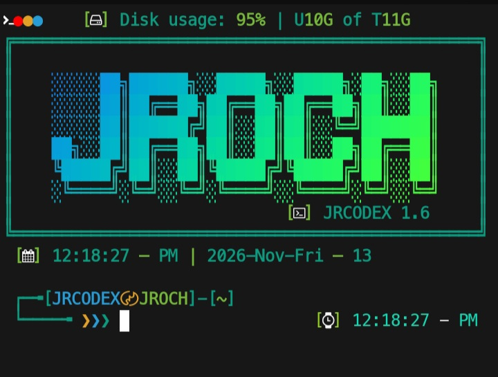

# JRCODEX

<p align="center">
  
  <br><br>
  
</p>

## 🔮 FEATURES:

- **`Advance Command found`**
- **`Advance Exit terminal`**
- **`Clear Terminal Visual Banner`**
- **`Auto Update Banner`**
- **`Advance ASCII ART`**
- **`Usage Timer`**
- **`Etc...`**
---

## 🧪 NAME & CMD:

- **Help Menu:** | `help`
- **Restore Terminal:** | `unstall` | `uninstall`
- **Change Name:** | `bname`
- **Update Banner:** | `update`
---


## 📱 INSTALL WITH TERMUX :

```bash
pkg update -y && pkg upgrade -y -o Dpkg::Options::="--force-confold" && for p in curl git ncurses-utils jq python; do command -v $p >/dev/null 2>&1 || pkg install -y $p; done && git clone https://github.com/jose0007rocha-cell/JRCODEX.git && cd JRCODEX/ && chmod +x * && bash install.sh
```
---

### 🐧 INSTALL WITH LINUX:

```bash
sudo apt update -y && sudo apt upgrade -y && for p in curl git ncurses-utils jq python; do command -v $p >/dev/null 2>&1 || sudo apt-get install -y $p; done && git clone https://github.com/jose0007rocha-cell/JRCODEX.git && cd JRCODEX/ && chmod +x * && bash install.sh
```
---


## ✨️ HELP MENU

```bash
help
```
---

<details id="missing-code-coverage">

  <summary>USE TOOL</summary>

##### How to use JRCODEX Banner tools

```bash

```

</details>

